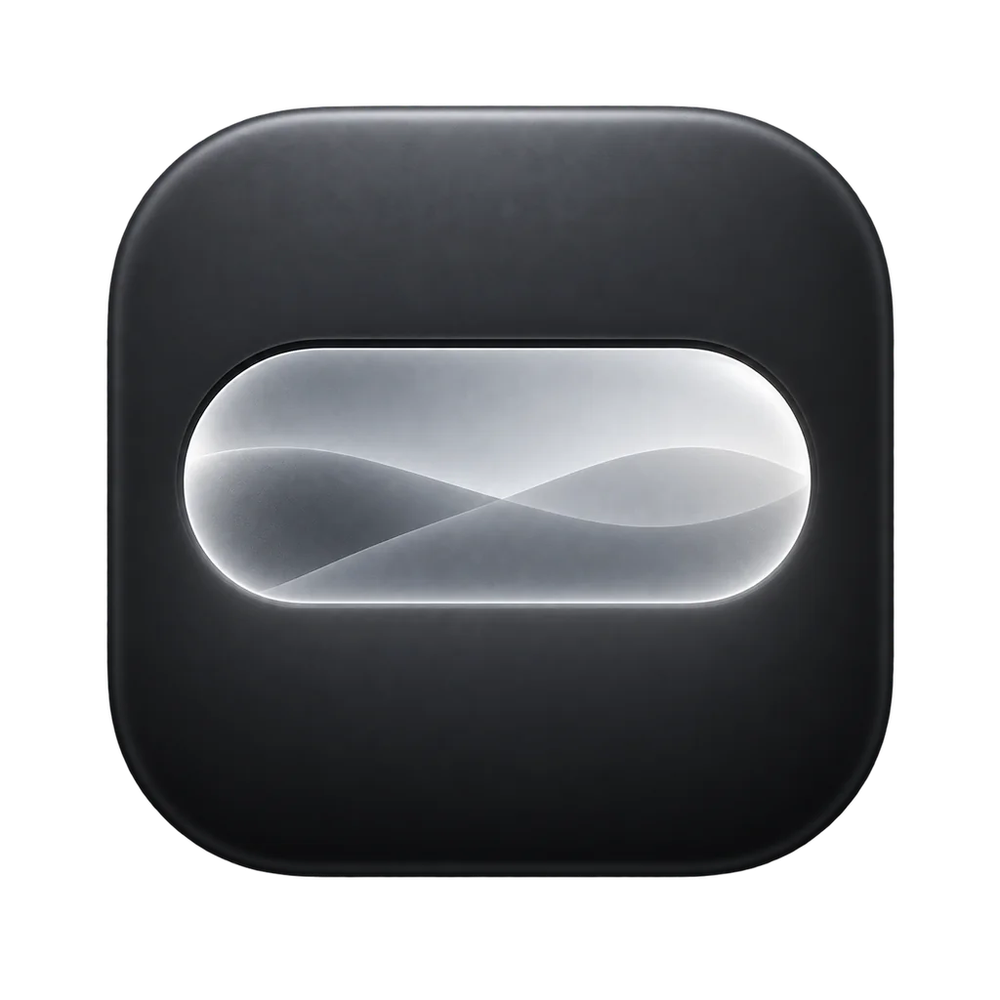
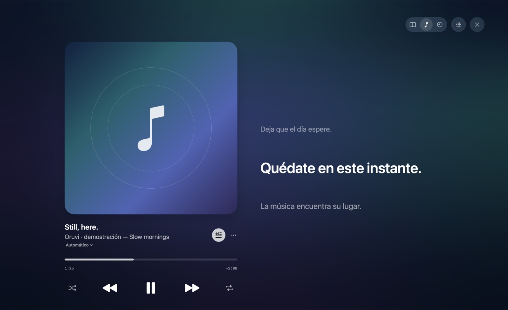
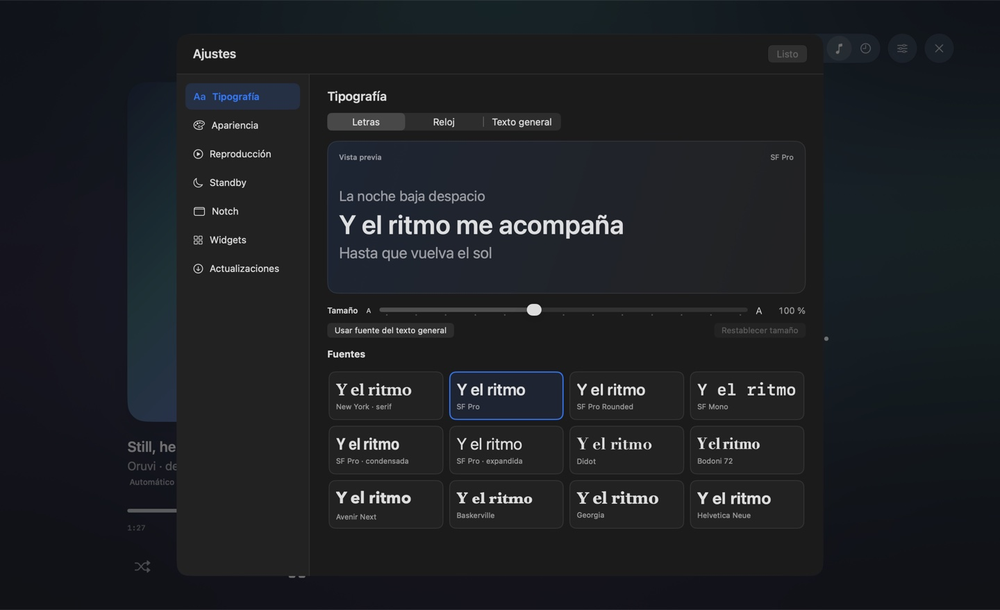

<h1 align="center">Oruvi</h1>

Controla tu música desde el notch y convierte tu Mac en un reloj con música y letras a pantalla completa.

  <a href="https://github.com/kaizentrick/oruvi/releases/latest/download/Oruvi.dmg"><strong>Descargar Oruvi.dmg</strong></a>
  · <a href="https://github.com/kaizentrick/oruvi/releases/latest">Última versión</a>
  · <a href=".github/CONTRIBUTING.md">Contribuir</a>

Apple silicon (M1 o posterior) · macOS 26 o posterior · <a href="LICENSE">Licencia MIT</a>

## Instalar Oruvi

1. [Descarga **Oruvi.dmg**](https://github.com/kaizentrick/oruvi/releases/latest/download/Oruvi.dmg). En la página de **Releases**, también lo encuentras en **Assets**. La descarga pública funciona sin cuenta de GitHub.
2. Abre el DMG y arrastra **Oruvi.app** a **Aplicaciones**.
3. Expulsa el disco y abre **Oruvi** desde **Aplicaciones**. Para probar el notch, acerca el puntero al borde superior de la pantalla. Para abrir Standby, usa el icono de Oruvi en la barra de menús y elige **Activar pantalla completa**.
4. Elige **Automático**, **Apple Music** o **Spotify**. Si macOS solicita Automatización para el reproductor elegido, concede el permiso para habilitar sus controles.

La versión pública usa firma ad-hoc y carece de notarización de Apple. Si macOS bloquea el primer inicio, confirma que descargaste el DMG desde este repositorio. Si confías en la copia, ve a **Ajustes del Sistema → Privacidad y seguridad → Abrir igualmente**. Algunas Mac administradas restringen esta opción. [Guía de Apple para abrir una app](https://support.apple.com/es-mx/102445)

Las próximas versiones se descargan desde GitHub con **Ajustes → Actualizaciones → Buscar versiones nuevas automáticamente** y **Descargar e instalar al salir cuando sea posible**. Sparkle verifica la firma Ed25519 antes de instalar.

## Explora Oruvi

- **Notch.** Controla música y abre Agenda, el temporizador y Conexiones desde el borde superior.
- **Standby.** Elige Reloj, Música o Reloj + música. Las letras sincronizadas aparecen cuando están disponibles.
- **Tipografía.** Compara fuentes y ajusta el tamaño de las letras con una vista previa en vivo.
- **Widgets.** Pon la portada y los controles de reproducción en el escritorio.

Las capturas muestran el modo de demostración con texto y portada de ejemplo.

## Participa

El código está disponible bajo [MIT](LICENSE). Puedes leerlo, modificarlo y compartirlo conservando el aviso de copyright y el texto de la licencia. Para proponer un cambio, crea un fork y abre un pull request. También puedes [reportar un problema o sugerir una mejora](https://github.com/kaizentrick/oruvi/issues/new). Consulta la [guía para contribuir](.github/CONTRIBUTING.md) y los [avisos de terceros](THIRD_PARTY_NOTICES.md).

Controles, compatibilidad y detalles técnicos

## Notch más ligero

El compacto en reposo conserva exactamente la franja superior que macOS informa para la cámara, sin añadir altura debajo. Muestra portada a la izquierda cuando hay canción y una nota musical a la derecha solo mientras reproduce. En pausa, ese lado queda vacío. En monitores sin recorte se une al borde superior: no hay separación ni cápsula flotante. Al fijar Codex, el compacto muestra su porcentaje restante en lugar de la portada.

El panel ampliado tiene cinco pestañas **solo con iconos**: Música, Archivos, Agenda, Temporizador y Conexiones. Las ayudas al detener el puntero y las etiquetas de VoiceOver conservan sus nombres. En Música se muestran una portada de 48 puntos, título, artista, selector de reproductor y anterior/pausa/siguiente. **Standby, Ajustes y Cerrar** se agrupan en el menú de tres puntos, sin fila inferior de iconos sueltos.

El ancho ampliado base es de 360 puntos. Música utiliza 158 puntos de contenido bajo la cámara; Conexiones, 280; los otros widgets, 240. Se adapta dentro de los límites de la pantalla y conserva el borde superior al cambiar de vista. Desde 0.12.0 la unión superior es cóncava en todas las pantallas, con y sin recorte. Se anima la superficie dentro de una ventana acotada de tamaño estable, no la ventana completa. Una transición interrumpida continúa desde el estado visible. Reducir movimiento y bajo consumo evitan esta animación.

### Apertura, también sobre la cámara

La zona de activación incluye toda la banda del notch, **12 puntos a cada lado y 10 debajo**, además del centro de la cámara y el borde superior exacto. Se comprueban coordenadas globales del puntero, sin depender exclusivamente de que una vista reciba un evento sobre píxeles visibles. Esto complementa el seguimiento nativo permanente y no depende de música, portada o conexión al reproductor.

La espera configurada para abrir es de **35 ms**, la expansión de **220 ms**, la contracción de **180 ms** y la tolerancia antes de cerrar de **220 ms**. Son parámetros de implementación, no mediciones de latencia en todos los equipos. Moverse dentro no reinicia el plazo. El clic habilita teclado; Esc, clic fuera o Cerrar cierran sin reabrir inmediatamente bajo un cursor inmóvil.

La zona interactiva sigue la forma visible, no el rectángulo completo del contenedor. Los márgenes transparentes se excluyen del hit testing y la entrada de la ventana se actualiza durante movimiento, animación y arrastre. Los monitores de movimiento son pasivos. Cerca del notch, una comprobación de respaldo recupera eventos ausentes detrás de la cámara cada 60 ms tras detectar movimiento y cada 500 ms con el puntero quieto. Se detiene lejos de la zona, durante Standby, bloqueo, reposo y al salir. No se observan teclas globales ni se guarda historial del puntero. Las pruebas geométricas no sustituyen una prueba física de entrega de clics entre ventanas. Detalles en [Resources/NOTCH.md](Resources/NOTCH.md).

### Personalizar el notch (0.11.0)

Abre **Notch → … → Personalizar notch**. **Avisos breves** muestra una franja de tres segundos al añadir archivos reales a la bandeja o terminar un temporizador. Pulsar el aviso abre su pestaña; también se puede descartar o desactivar. No se anuncia una transferencia de AirDrop por el mero hecho de añadir un archivo y no se reproducen avisos ocurridos con el notch oculto.

**Respuesta háptica** está desactivada inicialmente. Actívala para recibir respuesta nativa al abrir o cambiar de pestaña, según el dispositivo y las preferencias de macOS. No se dispara por cada movimiento del puntero ni por temporizadores y avisos.

**Pantalla del notch** permite elegir Automática o una pantalla detectada. La elección explícita se conserva aunque se desconecte la pantalla: se usa una alternativa y se recupera la preferida cuando vuelve. No modifica la pantalla ni el reproductor de Standby. **Guía del notch…** explica las funciones a petición, sin abrirse al iniciar.

Esta primera integración toma como referencia la presentación notch/isla de Glance, con implementación propia. No incorpora sus modelos, imágenes, videos ni código de credenciales. **No añade cámara, reconocimiento facial ni desbloqueo de macOS.**

## Conexiones y uso de Codex y Cursor

Abre **Notch → Conexiones → Codex → Conectar Codex**. Oruvi consulta la sesión de ChatGPT de Codex instalada en tu Mac mediante `account/rateLimits/read` del app server local. Requiere Codex CLI accesible en una ubicación habitual (`~/.local/bin`, Homebrew o el bundle de Codex); no solicita ni copia tokens, contraseñas o archivos de autenticación. Las cuentas con API key pueden no informar de estos límites.

Muestra los límites que la cuenta publique, sus periodos reales, el porcentaje restante y la fecha de reinicio. Si hay varios límites puedes elegir uno. **Uso visible en el notch** fija en el compacto el menor porcentaje restante entre las ventanas vigentes del límite elegido. No asume periodos de cinco horas ni interpreta un reinicio como permiso confirmado para volver a usar la cuenta.

Consulta aproximadamente cada minuto, suspende al bloquear o dormir la Mac y espacia reintentos cuando hay errores. Puedes actualizar manualmente o desconectar. Los estados sin sesión, sin CLI, sin conexión o vencidos se distinguen de 0% y 100%; no se guarda historial. Esta conexión no inicia conversaciones, no ejecuta tareas y no compra ni consume créditos de reinicio. Los límites pertenecen a la cuenta, no solo a este chat o a esta Mac.

En **Notch → Conexiones → Cursor → Conectar Cursor** puedes ver el porcentaje restante y el próximo reinicio de la cuota semanal compartida por Cursor y Grok. Requiere Aside con su CLI y una sesión de Grok iniciada en Aside. Oruvi lee la tarjeta de uso del panel de Grok cada cinco minutos mientras Conexiones está abierto, o cuando pulsas Actualizar.

Conexiones también lleva a reproducción, Agenda y widgets nativos. Los permisos se solicitan al activar cada función.

## Reproductores independientes

**Notch y Standby guardan selecciones separadas:** Automático, Apple Music o Spotify. Puedes usar, por ejemplo, Automático en el Notch y Apple Music en Standby. Cambiar uno no cambia el otro, ni siquiera desde Ajustes. Al actualizar, la preferencia anterior se copia una sola vez a ambos; las decisiones posteriores se conservan por separado.

El selector permanece visible incluso sin canción. Detecta aplicaciones mediante las API de macOS y solo ofrece opciones explícitas instaladas; **Automático siempre permanece disponible**. No instala ni inicia aplicaciones para detectarlas. Una preferencia guardada para una aplicación retirada se informa como no instalada, sin sustituirla silenciosamente. Las opciones se refrescan al abrir o acercarse al selector.

**Automático** sigue la sesión activa de «Ahora suena» de macOS, no la ventana que tenga el foco. Puede mostrar y controlar música, vídeo, podcasts y contenido de navegadores cuando el reproductor publique una sesión compatible. Apple Music y Spotify conservan sus puentes nativos, portadas y opciones propias. Sin datos del sistema se recupera la selección nativa anterior. Las opciones manuales siguen limitándose a aplicaciones instaladas y no cambian la preferencia de la otra superficie.

**Alcance y dependencia:** no significa controlar literalmente todo sonido ni garantiza compatibilidad con todos los sitios o versiones de macOS. Se integra MediaRemote Adapter, compilado de una revisión fija con licencia BSD-3-Clause. Usa una API privada que Apple puede cambiar; si falla, las integraciones nativas siguen disponibles. No se desactiva SIP, Gatekeeper ni la validación de bibliotecas. No hay captura de audio, pantalla, micrófono, historial o pestañas. Los controles vuelven a consultar el destino antes de actuar y se rechaza un cambio de posición si el contenido cambió. La portada depende de los datos publicados por cada app; no se inventa cuando falta.

Solo existe un muestreador de reproducción: al entrar o salir de Standby usa la preferencia de la superficie visible, cancela contenido pendiente y descarta respuestas antiguas. No se añaden dos bucles permanentes de consulta. El permiso o la desconexión de una superficie no modifica la selección guardada de la otra.

## Widgets nativos de macOS

Oruvi incorpora una extensión **WidgetKit** real, `OruviWidgets.appex`, dentro de la app. Se elimina la tarjeta flotante de 0.9.1: no hay otra ventana, chincheta ni temporizador gráfico de escritorio como sustituto del widget.

Instala la versión 0.10.0 o posterior en Aplicaciones y abre Oruvi al menos una vez. Después: **clic secundario en el escritorio → Editar widgets → busca Oruvi → Música y Standby**. Puedes elegir tamaño pequeño o mediano y colocarlo como cualquier widget del sistema. macOS administra posición, tamaño, apariencia y eliminación.

Incluye portada, título, artista, anterior/reproducir-pausar/siguiente y un icono para abrir Standby. Los controles utilizan App Intents en el proceso de Oruvi y no abren otra pantalla. El icono de Standby usa un enlace específico. El widget refleja el reproductor activo de Oruvi; las selecciones Notch y Standby siguen siendo independientes, con Automático, Apple Music y Spotify.

El widget no está ejecutándose continuamente: WidgetKit representa instantáneas y decide sus refrescos. Oruvi solicita actualización al cambiar el contenido, agrupa ráfagas y no escribe por cada segundo de progreso. No se garantiza portada instantánea en cada cambio; los controles validan sesión, pista y selección antes de actuar sobre un estado atrasado.

Para compartir datos entre procesos se conserva una instantánea local en la caché del App Group. Incluye el estado, los metadatos actuales, una miniatura JPEG de hasta 192 píxeles y su paleta. Si se detiene Apple Music o Spotify, el widget conserva la última portada disponible con el mensaje «Nada en reproducción». El archivo se sobrescribe de forma atómica, caduca y se elimina al cerrar Oruvi. WidgetKit también administra sus propias representaciones. La extensión no tiene permisos de red, Apple Events, cámara o micrófono.

En **Ajustes → Widgets** se muestran instrucciones y detección de widgets añadidos. La distribución actual sigue siendo ad-hoc, no notarizada: macOS puede solicitar acceso a datos compartidos o bloquear componentes según sus políticas. La validación del runner no reemplaza comprobar la galería en una instalación normal. No desactives SIP o Gatekeeper. Detalles de firma y diagnóstico en [Resources/MEDIA.md](Resources/MEDIA.md).

## Widgets del notch

**Archivos y AirDrop.** Arrastra un archivo local desde Finder hacia el notch. La zona de acercamiento abre Archivos automáticamente y muestra «Suelta para añadir», incluso con elementos en la bandeja. Solo se añade al soltarlo; cancelar o retirarlo restaura la vista anterior. También hay selector de archivos, selección múltiple, arrastre hacia otras apps y Mostrar en Finder. Hasta 20 referencias temporales, sin duplicados. Vaciar o retirar **no borra, mueve ni copia los originales**. La bandeja se vacía al cerrar Oruvi y no se guarda en disco.

AirDrop utiliza el selector nativo de macOS mediante `NSSharingService.sendViaAirDrop`: tú eliges el destinatario. Sin selección se ofrece la bandeja completa; con elementos marcados solo esos. El resultado procede del sistema. Oruvi no simula dispositivos ni cambia Wi-Fi/Bluetooth ni envía archivos sin intervención. Se aceptan archivos locales, no promesas de archivos de cualquier app ni enlaces web; el original debe seguir existiendo. No se inspeccionan contenidos, carpetas recursivas ni el portapapeles general. La anticipación solo consulta tipos anunciados en el portapapeles de arrastre durante el gesto y cerca del notch.

**Agenda.** Está desconectada inicialmente. Conectar Calendario solicita autorización EventKit. macOS exige acceso completo para consultar eventos. Oruvi muestra hasta seis próximos eventos de los siguientes 31 días y marca los días con eventos del mes que estás viendo. Selecciona un día de hoy en adelante para ver los eventos que quedan. Agenda consulta Calendario mientras la pestaña está visible y retira los datos al cerrarla. Desconectar detiene la función en Oruvi. Puedes revocar el permiso en Privacidad y seguridad → Calendarios.

**Temporizador.** Intervalos de 5, 15 y 25 minutos con pausa, reinicio y repetición. `ContinuousClock` incluye reposo y no depende de cambios de fecha/zona horaria. Hay un vencimiento de fondo, no un bucle por segundo; el contador visual solo se actualiza con su vista abierta. Sonido opcional, desactivado inicialmente. No crea alarmas en Reloj ni cambia Concentración y se cancela al cerrar Oruvi.

El cierre automático y Standby por inactividad esperan mientras se usan diálogos nativos o un arrastre.

## Standby, letras y malla

Standby conserva Reloj, Música y Reloj + música a pantalla completa. Oculta el notch, Dock y menú durante la presentación y los restaura al salir con Esc. No sustituye la pantalla de bloqueo ni se muestra sobre pantallas protegidas. Ajustes no se abre automáticamente al iniciar.

El selector de Standby está en Música y en la barra superior de las otras dos vistas; Ajustes permite cambiar ambos selectores. La portada abre el reproductor mostrado: el destino se captura antes de abandonar la presentación y volver a la preferencia del notch.

Las letras de LRCLIB y de archivos LRC ya guardados se sincronizan por línea. El botón Letras aparece cuando hay una letra disponible. Sin letra, la vista Música centra el reproductor. Reloj + música coloca el reloj a la izquierda y la pista con sus controles a la derecha.

En Ajustes → Tipografía puedes comparar fuentes y ver al instante el tamaño de las letras, el grosor del reloj y la fuente del texto general.

La malla Aurora tiene alternativas Atardecer y Medianoche, con adaptación a la portada e interpolación de color independiente de los controles. Una respuesta de portada antigua no cambia la canción nueva. Las imágenes de Spotify se descargan únicamente desde dominios permitidos de la URL suministrada por la app, sin sustituirlas por otro catálogo ni guardarlas en la caché persistente.

Se emplean fuentes nativas del sistema; no se incluyen ni descargan archivos de fuentes. Se respetan Reducir movimiento y Reducir transparencia.

## Energía y privacidad

No hay captura de pantalla, cámara, micrófono, audio, historial o pestañas; tampoco telemetría propia, Electron ni WebView. La nota musical es un estado, no un visualizador. Las letras no se consultan para el notch compacto.

Fuera de Standby, las consultas musicales se espacian aproximadamente 3 segundos con corriente y 5 en batería mientras reproduce, y más al pausar; las notificaciones pueden anticipar actualizaciones. En Automático se comprueban ambos proveedores en ejecución, a diferencia de las versiones anteriores que se detenían en el primero. La detección del puntero no ejecuta consultas de reproducción por movimiento.

En Standby, Automático limita la malla a 24 fps con corriente y la deja estática en batería. Fluido permite hasta 30/12 fps; Ahorro, bajo consumo, calor y Reducir movimiento detienen la animación. El reposo y bloqueo suspenden reproducción y Agenda; un temporizador iniciado conserva su vencimiento. Son políticas de implementación, no cifras medidas de autonomía o memoria.

La protección multimedia y la opción conservadora de navegadores se mantienen. No se garantiza detección universal de vídeos silenciosos. Las búsquedas externas de letras y portada envían los metadatos necesarios a LRCLIB/Apple/servidores de imágenes de Spotify; esos servicios reciben la IP. No se envían documentos o eventos de Agenda a servidores propios.

## Actualizaciones y desarrollo

Usa **Buscar actualizaciones** en Oruvi. Sparkle comprueba el feed y el archivo con Ed25519. El enlace humano fijo descarga `Oruvi.dmg`; el feed usa el DMG numerado de una release concreta, no ese alias. No borres releases publicadas que puedan necesitar versiones anteriores.

Los PR ejecutan comprobaciones y compilación completa en GitHub con `ORUVI_REPOSITORY=''`, sin secretos ni publicación. Solo `main` publica: valida, compila, verifica, firma y sube todos los recursos antes de hacer Latest. Un fallo no sustituye el instalador anterior. Los cambios de documentación no empaquetada no consumen una compilación.

Para compilar una copia de desarrollo, sigue la [guía para contribuir](.github/CONTRIBUTING.md).

`bash scripts/configure-downloads.sh` permite publicar desde el Terminal del mantenedor usando su sesión normal de GitHub CLI. No evade restricciones de acceso ni cambia otros repositorios.

**Conserva una copia cifrada de `.private/sparkle.key`.** Nunca se sube a Git; la app solo contiene la clave pública y CI utiliza `ORUVI_SPARKLE_PRIVATE_KEY`. Developer ID y las credenciales de notarización son independientes: la compilación local admite `SIGN_IDENTITY` y `NOTARY_PROFILE`. No marques una release como notarizada sin verificarlo.

## Verificación

Se conservan las pruebas de lógica existentes y las matrices de selección automática, aplicaciones instaladas, preferencias separadas, migración, cámara/bordes y pantallas múltiples. En 0.11.0 se añaden comprobaciones parametrizadas de silueta, límites de entrada, coordenadas de pantalla, avisos y antirrebote, además de pruebas del animador real y su cancelación. La compilación ejecuta además pruebas sobre el modelo real de Oruvi con preferencias aisladas, sin abrir reproductores, solicitar permisos ni hacer búsquedas externas. Se verifican el flujo asíncrono del widget, su lectura entre procesos, la extensión nativa, la firma y el icono. El DMG se monta y se verifican firma, binario y copia de la licencia.

Estas pruebas **no equivalen a una sesión interactiva en todos los modelos de Mac**, una transferencia real de AirDrop, la sensación física del trackpad ni pruebas con permisos/cuentas reales de Calendario o Spotify. No se afirman benchmarks nuevos; la compilación y las pruebas no sustituyen verificar los permisos y la galería en cada instalación.

## Licencia y atribución

El código de Oruvi se distribuye bajo la **MIT estándar**, con copyright de KaizenTrick. Permite usar, copiar, modificar y redistribuir, incluso comercialmente, conservando el aviso de copyright y la licencia en copias o porciones sustanciales. No es una prohibición de reutilización del código. El archivo completo se incluye en el repositorio, dentro de la app y en el DMG.

La licencia propia no transfiere derechos sobre letras, música, imágenes, tipografías o componentes de terceros. Consulta [THIRD_PARTY_NOTICES.md](THIRD_PARTY_NOTICES.md) y [SECURITY.md](SECURITY.md). Oruvi es independiente de Apple y Spotify y no incorpora código ni recursos de Boring Notch. La referencia de diseño de Glance y los límites de esta adaptación están documentados en [Resources/NOTCH.md](Resources/NOTCH.md).

### Recuperación de widgets (0.10.1)

Desde 0.12.0, actualizar desde Ajustes solicita también la recarga del widget. La renovación periódica mantiene vigente su timeline aunque la canción siga pausada. Los errores de acceso conservan su explicación y el contenido caduca en su plazo real.

Si el widget no recibe datos, abre **Oruvi → Widgets de macOS → Conectar y actualizar widgets**. Si aparece un aviso de datos compartidos, autoriza Oruvi. Los detalles de autorización están en [Resources/MEDIA.md](Resources/MEDIA.md).

